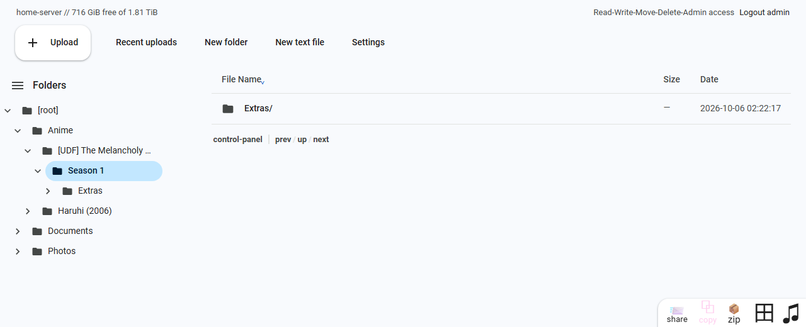
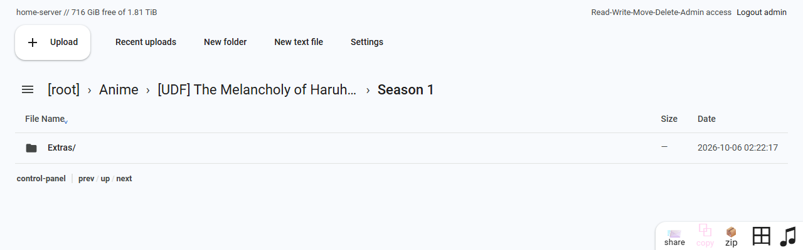
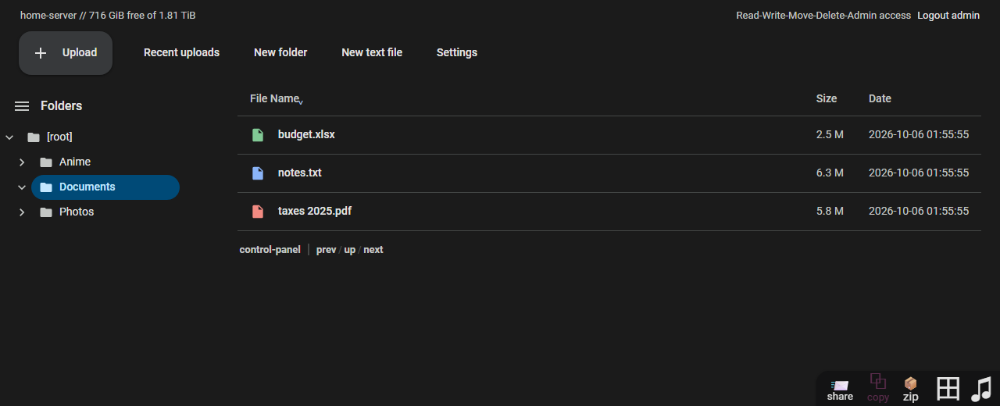
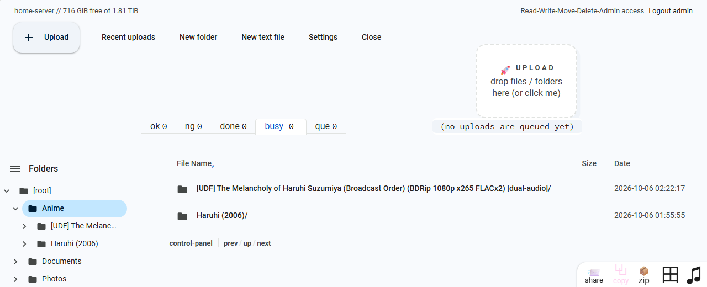
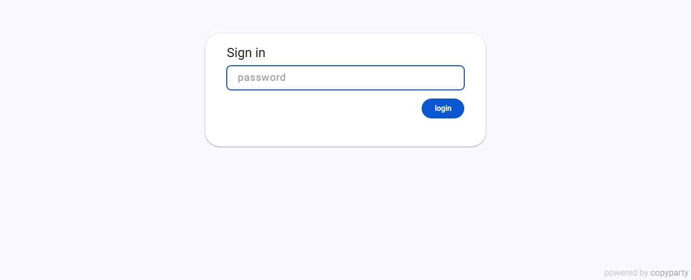

# copyparty-drive-theme

A Google Drive-flavoured skin for [copyparty](https://github.com/9001/copyparty). It doesn't try to be a pixel-perfect clone, just something familiar and less busy than the default UI.



## What it changes

- Drive-like colours, font, and a clean file list with type icons (folders, video, images, audio, archives, PDFs, docs, sheets)
- Labelled toolbar buttons instead of emoji: **Upload**, **Recent uploads**, **New folder**, **New text file**, **Settings**
- A Drive-style **Folders** sidebar with chevrons, folder icons and single-line names; the ☰ button switches between it and breadcrumbs (**[root] › Anime › …**)
- Rarely needed tools are hidden: basic uploader, "send message to server log", media player options, and the advanced upload toggles
- The "c" and "T" columns are hidden, and folders show "—" instead of a size
- The sign-in and password-protected share pages become a simple sign-in card
- Follows the system light/dark preference, and overrides whichever copyparty theme is selected in Settings
- Narrow screens hide the date column and server info

| Breadcrumbs                                | Dark                           |
| ------------------------------------------ | ------------------------------ |
|  |  |

| Upload                                 | Sign in                           |
| -------------------------------------- | --------------------------------- |
|  |  |

## Install

1. Copy just `drive.css` into a folder on the server that holds nothing else (not a clone of this repo, since everything in that folder becomes public):

   ```sh
   mkdir -p /srv/copyparty-theme
   cp drive.css /srv/copyparty-theme/
   ```

2. Add this to your copyparty config:

   ```toml
   [global]
     html-head-s: <link rel="stylesheet" href="/.theme/drive.css">
     ui-filesz: 3    # sizes like "2.2 M" instead of "2 345 678"

   [/.theme]
     /srv/copyparty-theme
     accs:
       g: *
   ```

   `g` lets everyone download files from `/.theme` without being able to list it, so the sign-in page and share links are themed too. Anything in that folder is still public to anyone who guesses its name, so keep only the theme there.

3. Restart copyparty.

`html-head-s` loads the stylesheet on every copyparty page. To theme only the file browser, use `css-browser: /.theme/drive.css` instead; the sign-in page then keeps copyparty's default look.

## Notes

- Tested against copyparty v1.20.24. The theme targets copyparty's element IDs, so a future copyparty release that renames them may need small fixes.
- Hidden features are only hidden with CSS. To bring one back, delete its selector from `drive.css` (for example `#opa_bup` for the basic uploader).
- Icons are from [Material Symbols](https://fonts.google.com/icons) (Apache 2.0), inlined as SVG.
